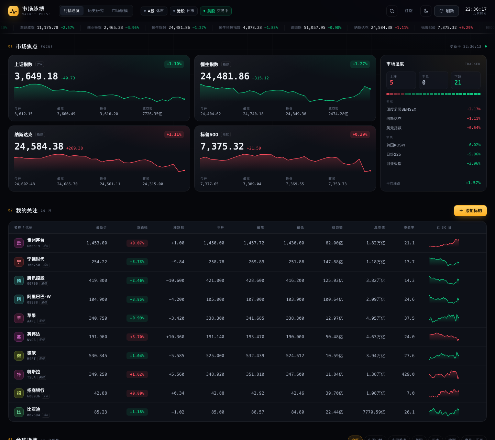
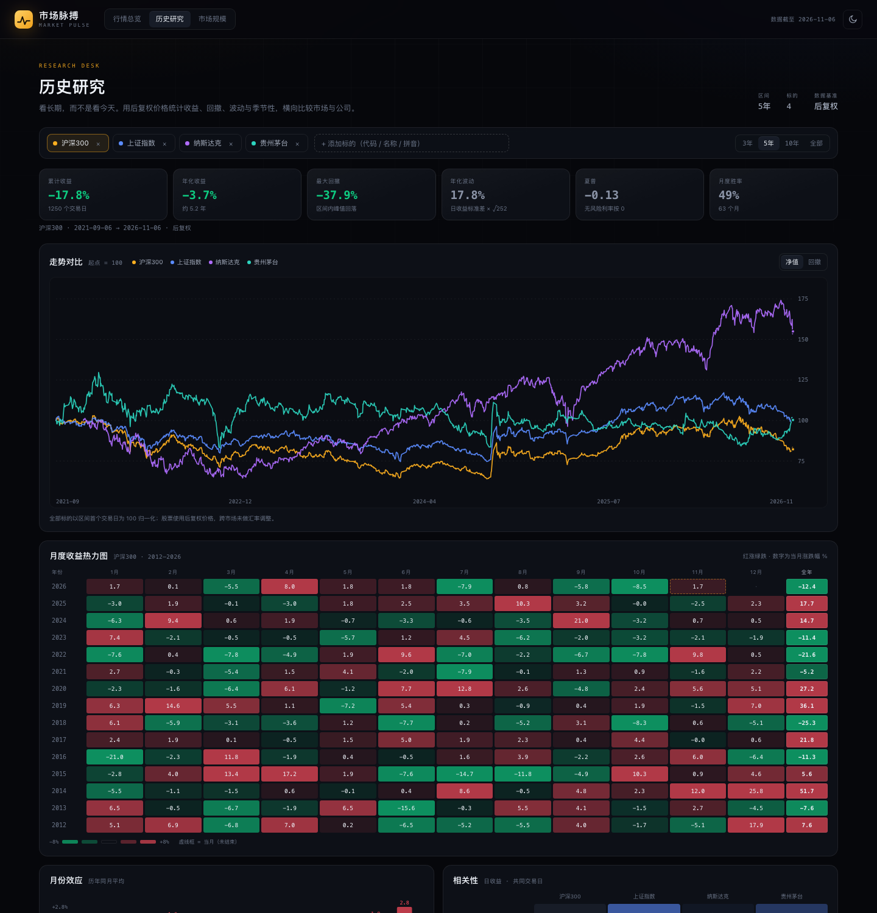
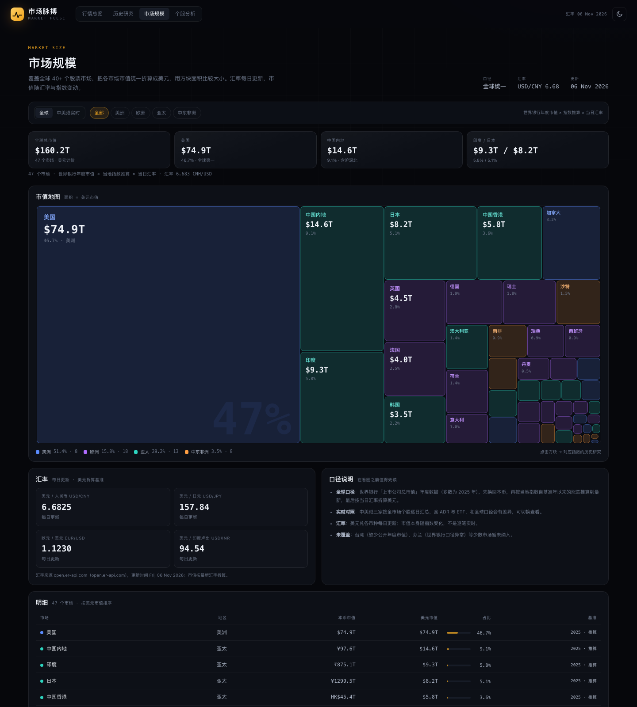
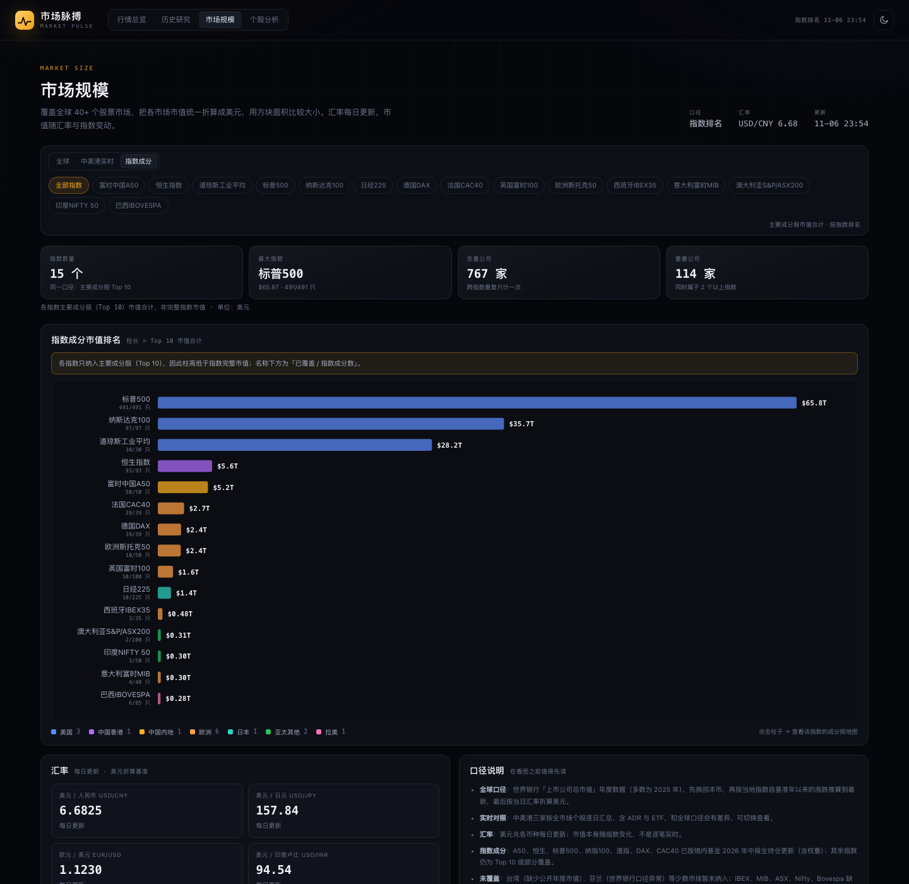
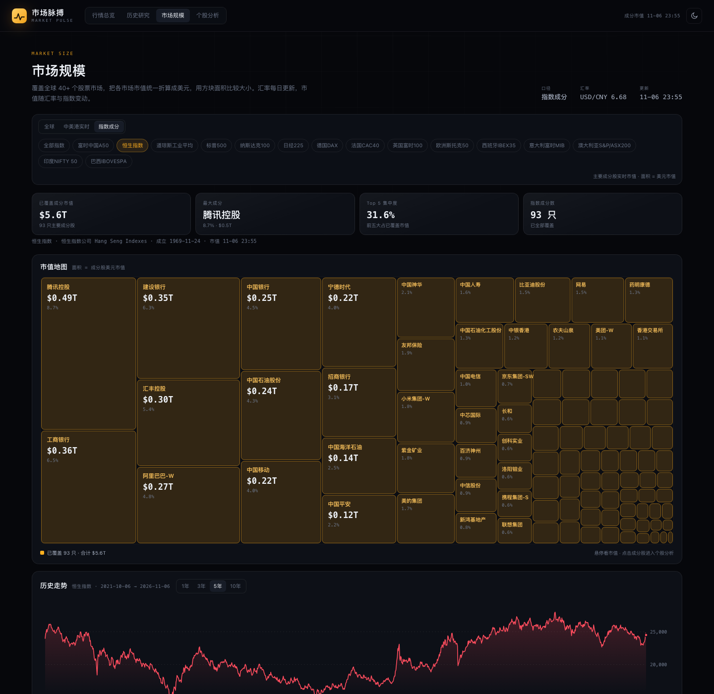
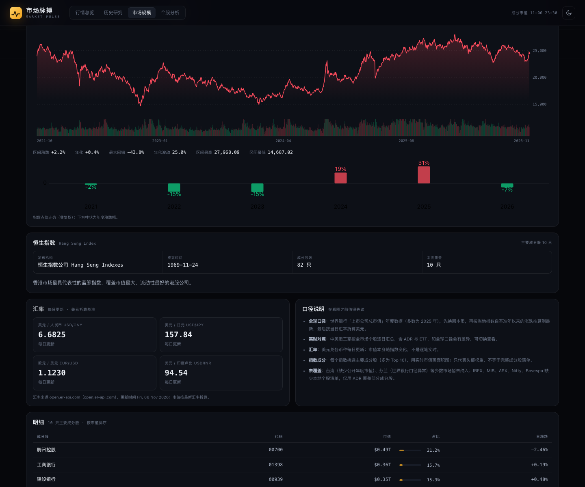
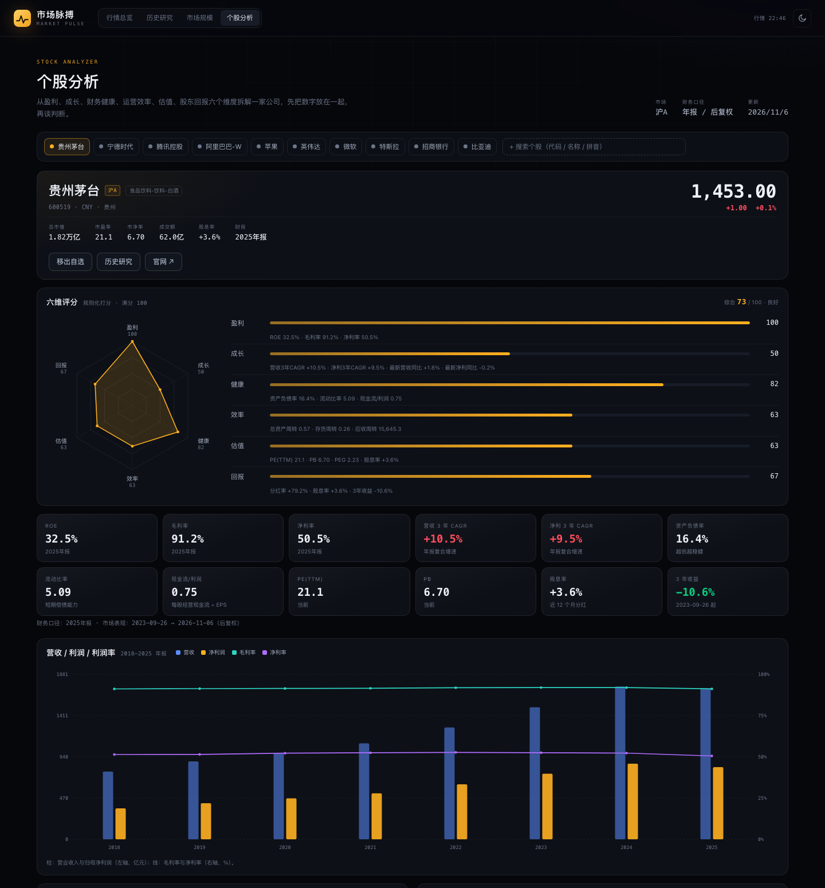
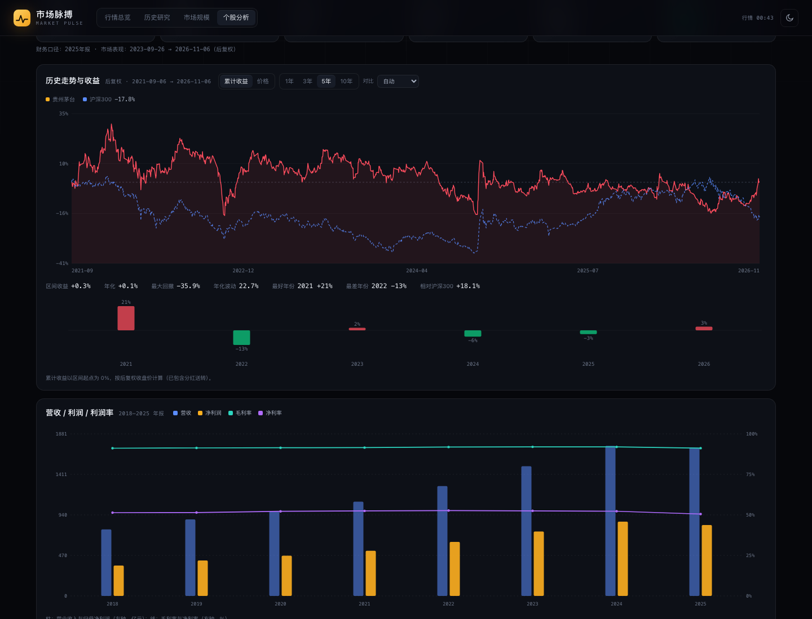
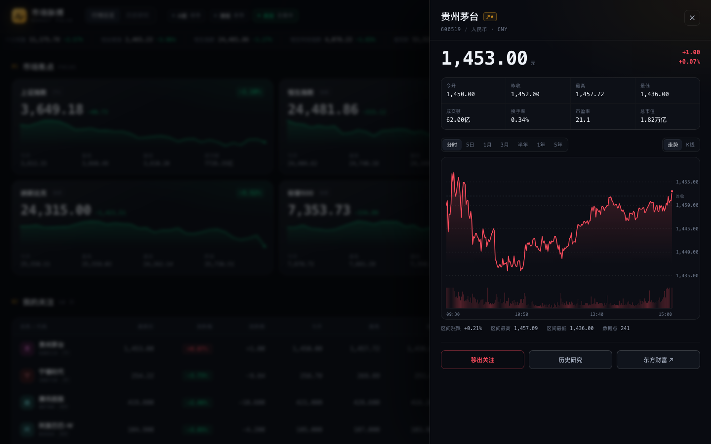
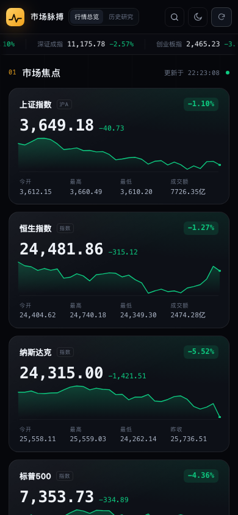

# 市场脉搏 · Market Pulse

[](https://github.com/clawcode3-bit/market-pulse/actions/workflows/ci.yml)

> A self-hosted, zero-dependency market dashboard: global indices, long-horizon research,
> market-cap maps, and single-stock analysis. Data from Eastmoney public endpoints; runs entirely
> on your own machine.

一个个人用的行情与研究面板：**看今天，也看长期**。

- **行情总览**：全球指数 + 自选股的实时快照，一眼看清涨跌。
- **历史研究**：用后复权价格做区间统计、月度热力图、回撤与相关性，研究公司和市场的长期规律。
- **市场规模**：各市场上市公司市值统一折算成美元，用面积比较大小，汇率每日更新。
- **个股分析**：从盈利、成长、财务健康、运营效率、估值、股东回报六个维度拆解一家公司。

数据来自东方财富公开接口，纯本地运行，不需要注册、不需要 API Key、不需要数据库。



## 快速开始

```bash
cd market-pulse
node server.js
# 行情总览  http://127.0.0.1:5173
# 历史研究  http://127.0.0.1:5173/research.html
# 市场规模  http://127.0.0.1:5173/markets.html
# 个股分析  http://127.0.0.1:5173/stock.html
```

要求 Node.js ≥ 18（零第三方依赖，无需 `npm install`）。

自定义端口 / 局域网访问（手机同 Wi-Fi 可直接打开）：

```bash
PORT=8080 HOST=0.0.0.0 node server.js
```

## 理念

行情工具大多在争夺注意力：推送、弹窗、涨停提醒、荐股。Market Pulse 想反着来——把噪音关掉，把时间尺度拉长，把数据口径写清楚，让判断回到使用者手里。

- **看今天，也看长期**：首页是行情，重心在历史；后复权、十年区间、回撤、相关性、季节性。
- **数据诚实**：估算值标“约”，覆盖不全标“部分覆盖”，没有的东西不假装有。
- **工具属于使用者**：零依赖、本地运行、自选存 `localStorage`；没有账号、云端和埋点。
- **不替你做决定**：不荐股、不给目标价、不预测，只把数字和它们的来龙去脉摆在一起。

它不是交易终端，也不是资讯聚合器，更像一张自己的工作台：几个顺手的工具，放在该在的位置。

[完整理念与项目简介 →](docs/PHILOSOPHY.md)

> In English: a self-hosted, zero-dependency dashboard for studying markets over years, not refreshing quotes every minute. It shows its sources and gaps, and never tells you what to buy.

## 行情总览

| 模块 | 说明 |
| --- | --- |
| 市场焦点 | 上证、恒生、纳指、标普 4 张大卡，含 30 日走势与关键价位 |
| 市场温度 | 26 个跟踪指数的涨跌家数、强弱分布、领涨/领跌与平均涨跌 |
| 我的关注 | 现价、涨跌幅、今开/最高/最低、成交额、总市值、市盈率、30 日迷你走势 |
| 全球指数 | 中国内地 / 香港 / 美国 / 亚太 / 欧洲 / 商品汇率 六组共 26 个指数 |
| 详情抽屉 | 分时 / 5 日 / 1 月 / 3 月 / 半年 / 1 年 / 5 年，走势线 ↔ K 线，十字光标 |
| 搜索添加 | 名称、代码、拼音首字母；A 股、港股、美股、指数都能加入关注 |
| 其他 | 30 秒自动刷新、排序、红涨绿跌切换、明暗主题、链接直达、移动端适配 |

## 历史研究



| 模块 | 说明 |
| --- | --- |
| 区间统计 | 累计收益、年化收益、最大回撤、年化波动、夏普、月度胜率 |
| 走势对比 | 最多 5 个标的按日期对齐、起点归一化为 100；可切换「回撤」视图 |
| 月度热力图 | 近 15 年 × 12 个月的涨跌矩阵，带全年汇总；一眼看季节性 |
| 月份效应 | 历年同月平均收益 + 胜率，检验「几月容易涨」这类经验 |
| 相关性 | 日收益的 N×N 相关矩阵（共同交易日） |
| 区间统计表 | 所有标的横向对比，可点击切换当前标的 |
| 公司档案 | A 股：最新报告期 + 近 6 年营收/净利/同比/ROE/毛利率/净利率/资产负债率 |

支持从行情页直达：打开任意标的详情 → 「历史研究」；也支持 `/research.html?s=1.600519`。

## 市场规模



| 模块 | 说明 |
| --- | --- |
| 全球市值地图 | 47 个市场，面积 = 美元市值；按地区着色（美洲/欧洲/亚太/中东非洲），可筛选 |
| 全球口径 | 世界银行「上市公司总市值」年度数据 → 本币 → 按当地指数涨跌推算到最新 → 当日汇率折美元 |
| 实时对照 | 中美港三家按全市场个股逐日汇总（含 ADR/ETF），可一键切换 |
| 指数成分 | 15 个指数的成分股市值面积图，附指数简介、发布机构、成立时间 |
| 汇率面板 | USD/CNY、USD/JPY、EUR/USD、USD/INR，每日更新 |
| 明细表 | 美元市值、本币市值、占比、基准年份（年度值 / 指数推算） |

覆盖范围：美国、中国内地、中国香港、日本、印度、韩国、新加坡、印尼、马来西亚、泰国、菲律宾、越南、
澳大利亚、新西兰、英国、德国、法国、荷兰、瑞士、西班牙、意大利、瑞典、丹麦、挪威、比利时、葡萄牙、
爱尔兰、奥地利、波兰、希腊、土耳其、俄罗斯、加拿大、巴西、墨西哥、智利、哥伦比亚、秘鲁、阿根廷、
沙特、阿联酋、以色列、南非、埃及、尼日利亚、肯尼亚、摩洛哥。

口径说明：全球口径是**估算**——世界银行年度市值（多数为 2025 年）× 当地指数涨跌 × 当日汇率，
不同市场基准年份不同；台湾（缺少公开年度市值）、芬兰（世界银行数据异常）暂未纳入。
中美港实时口径含 ADR/ETF，与全球口径不可直接相加。

### 指数成分



**全部指数**：15 个指数按「已接入成分市值合计」排名的横向柱状图，柱子颜色代表所属市场。
其中 7 个已按境内基金中报全持仓刷新，其余仍为 Top 10；点击柱子进入该指数的成分股地图，
名称下方标注「已覆盖 / 指数成分数」（例如 491/491 表示全持仓，10/500 表示只纳入了前十大）。



覆盖 15 个指数：富时中国A50、恒生、道琼斯、标普500、纳斯达克100、日经225、德国DAX、法国CAC40、
英国富时100、欧洲斯托克50、西班牙IBEX35、意大利富时MIB、澳洲ASX200、印度NIFTY 50、巴西IBOVESPA。

- 「全部指数」：15 个指数的市值排名柱状图（Top 10 合计，标注覆盖数）。
- 单个指数：用实时市值画面积图；点击成分股（树状图 / 明细表 / 前十大权重）都会跳到该股的个股分析页。
- 全持仓：富时A50（50）、恒生（93）、标普500（491）、纳指100（97）、道指（30）、DAX（39）、CAC40（39）；其余为 Top 10 或部分覆盖。
- 历史走势：每个指数可切 1 / 3 / 5 / 10 年，含区间涨跌、年化、最大回撤、年化波动、区间高低，以及年度涨跌柱状图。
- A50 名单与权重：按嘉实富时中国A50ETF 2026 年中期报告的全持仓更新（50 只全量 + 占净值权重，截至 2026-06-30）；富时官方 factsheet（2026-10-30）仅披露前五大与行业分布，可作为交叉核对。


- 详情含：指数简介、发布机构、成立时间、成分股数、本页覆盖数。
- 已按境内基金 2026 年中报全持仓刷新的指数：富时A50（嘉实512550）、恒生（华夏159920）、
  标普500（博时513500）、纳指100（国泰513100）、道指（鹏华513400）、DAX（嘉实159561）、CAC40（华安513080）。
- 其余指数仍为 Top 10 或部分覆盖：IBEX、MIB、ASX200、NIFTY、IBOVESPA 仅用 ADR 覆盖 3–7 只，页面会显示「部分覆盖」提示；
  日经225、巴西的境内 ETF 只持有期货/目标 ETF，没有个股清单。
- 面积按成分股**总市值**绘制，不等于官方指数权重（指数权重是自由流通市值调整后的）。

## 个股分析



### 历史走势与收益



- 累计收益 / 价格两种视图，1 / 3 / 5 / 10 年切换
- 区间收益、年化、最大回撤、年化波动、最好年份、最差年份
- 对比基准：默认按市场自动选沪深300 / 恒生指数 / 标普500，也可手动切换或关闭；统计里给出「相对基准」
- 年度涨跌幅柱状图；十字光标悬浮显示日期、累计收益、基准与相对收益
- 价格按当前股价折算（前复权口径），累计收益按后复权收盘价计算

| 模块 | 说明 |
| --- | --- |
| 六维评分 | 盈利 / 成长 / 健康 / 效率 / 估值 / 回报，各 0–100 分，附雷达图与逐项指标 |
| 关键指标 | ROE、毛利率、净利率、3 年 CAGR、资产负债率、流动比率、现金流/利润、PE、PB、股息率、3 年收益 |
| 财务趋势 | 8 年营收与净利柱状 + 毛利率/净利率折线 |
| 现金流质量 | 每股经营现金流 ÷ EPS，检验利润是否有现金支撑 |
| 估值与回报 | PE、PB、PEG、股息率、分红率、每股股息 |
| 公司简介 | 主营、行业、董事长、员工、官网、邮箱、地址（A 股与港股） |
| 股东与分红 | 十大股东、股东户数变化、近 10 次分红方案 |

评分是透明规则（阈值线性映射 + 加权），不是黑箱模型；缺失指标不参与计算，所以不同公司间只适合粗比。
港股目前只有公司资料与行情指标，美股只有行情与估值；A 股数据最完整。

## 截图

| 详情抽屉 | 移动端 |
| --- | --- |
|  |  |

## 目录结构

```
market-pulse/
├── server.js              # 零依赖 Node 服务：静态站点 + 行情代理 + 缓存
├── package.json
├── data/indices.json      # 15 个指数与主要成分股配置
├── public/
│   ├── index.html         # 行情总览
│   ├── app.js             # 行情页逻辑
│   ├── research.html      # 历史研究
│   ├── research.js        # 研究页逻辑（统计、热力图、相关性）
│   ├── research.css       # 研究页样式
│   ├── markets.html       # 市场规模
│   ├── markets.js         # 市值汇总、汇率折算、面积图
│   ├── markets.css        # 市场规模页样式
│   ├── stock.html         # 个股分析
│   ├── stock.js           # 评分、图表、公司资料
│   ├── stock.css          # 个股分析页样式
│   ├── styles.css         # 共享设计系统（暗/亮双主题）
│   └── charts.js          # 手写 SVG：迷你走势、K 线、多标的对比图
└── docs/                  # 预览图
```

## 架构与接口

```
浏览器 ──► /api/*（本地 Node，缓存 + 失败回退）──► 东方财富 push2 / push2his / datacenter
```

| 接口 | 作用 | 缓存 |
| --- | --- | --- |
| `GET /api/quotes?secids=1.000001,105.NVDA` | 批量报价 | 8 秒 |
| `GET /api/sparks?secids=…&days=30` | 近 N 日收盘（迷你走势） | 10 分钟 |
| `GET /api/history?secid=…&range=1d…5y` | 分时 / 日 K（前复权） | 45 秒 / 5 分钟 |
| `GET /api/closes?secids=…&range=3y…max` | 批量后复权收盘（研究统计） | 15 分钟 |
| `GET /api/monthly?secids=…&lmt=480` | 批量月线收盘（热力图） | 30 分钟 |
| `GET /api/fundamentals?secid=1.600519` | A 股主要财务指标 | 6 小时 |
| `GET /api/markets` | 中美港总市值/流通市值 + 当日汇率（实时口径） | 6 小时 / 30 分钟 |
| `GET /api/world-markets` | 全球 47 个市场市值（世界银行 + 指数推算 + 汇率） | 6 小时 |
| `GET /api/index-list` | 15 个指数的基本信息 | — |
| `GET /api/index-map?id=spx` | 指数主要成分股的实时市值（美元） | 8 秒（复用报价缓存） |
| `GET /api/company?secid=1.600519` | 公司资料 + 财务 + 股东 + 分红 | 6 小时 |
| `GET /api/search?q=茅台` | 标的搜索 | 5 分钟 |

- 服务端做了 **并发限制 + 内存缓存 + 上游失败回退**，行情抖动时页面不会白屏。
- 前端不依赖任何 CDN，图表全部手写 SVG，断网也能打开页面（只是没有新数据）。
- 证券代码采用东方财富的 `市场.代码` 格式：`1.` 沪市、`0.` 深市/北交所、`100.` 全球指数、`101/102.` 商品、`105/106.` 美股、`116.` 港股、`124.` 港股指数。

## 部署

```bash
# 本机
node server.js

# 局域网（手机同 Wi-Fi 访问 http://<本机IP>:5173）
HOST=0.0.0.0 PORT=5173 node server.js

# Docker
docker build -t market-pulse .
docker run -d -p 5173:5173 --name market-pulse market-pulse
```

公网访问推荐 Cloudflare Tunnel（不用公网 IP，自带 HTTPS）：

```bash
cloudflared tunnel --url http://127.0.0.1:5173
```

注意：项目本身没有登录鉴权，公网暴露前请自行加反向代理 Basic Auth 或 Cloudflare Access。

## 数据口径（重要）

- **研究统计一律使用后复权（fqt=2）价格**。前复权在长历史上会出现负价格（例如茅台 2001 年的前复权价为 -312），会直接算错收益率，所以研究台不用它。
- 行情页的 K 线仍用前复权，这样最新价和页面上的报价一致。
- 指数、商品不做复权；跨市场对比**未做汇率调整**（人民币、港币、美元直接比）。
- 日线单次最多约 6000 根（A 股约到 2005 年，指数约到 2002 年），月线可到 1990 年；热力图固定取近 15 年。
- 财务数据目前只覆盖 **A 股**；港股/美股只做价格层面的研究。
- 夏普比率按无风险利率 = 0 计算；年化波动 = 日收益标准差 × √252。
- 市场规模分两套口径：全球口径是世界银行年度市值 × 指数推算的估算值（含基准年份），实时口径只覆盖中美港且含 ADR/ETF；两者不可直接相加。
- 个股评分是规则化打分（阈值由我按常见财务标准设定），不是评级机构结论，也不构成投资建议；港股/美股财务数据暂缺，只能做价格与估值层面的分析。

## 想改点什么

| 需求 | 改哪里 |
| --- | --- |
| 换名字 / 文案 | `public/index.html`、`public/research.html` |
| 行情页默认自选 / 指数分组 / 刷新频率 | `public/app.js` 的 `DEFAULT_WATCH`、`GROUPS`、`REFRESH_MS` |
| 研究页默认标的 / 快选列表 | `public/research.js` 的 `DEFAULTS`、`PRESETS` |
| 配色 / 圆角 / 字体 | `public/styles.css` 的 `:root` |
| 行情字段、缓存策略 | `server.js` |

## 已知边界

- 数据源为非官方公开接口，字段与可用性可能随时变化；长期或多人使用建议换持牌数据源（Tushare Pro、聚源、Wind、Polygon 等）。
- 行情为快照，非逐笔实时；休市时显示最近一个交易日的收盘数据。
- 自选与研究标的保存在本地浏览器 `localStorage`，不跨设备同步。
- 历史规律不代表未来表现，本项目仅供个人研究，不构成投资建议。

## 发布

推送 `v*` 标签会自动创建 GitHub Release（自动生成 changelog，`-rc` 等后缀会标为 prerelease）：

```bash
git tag v0.2.0
git push origin v0.2.0
```

`package.json` 的 `version` 需要与 tag 一致，否则 Release workflow 会失败。

## 贡献

欢迎 issue / PR。提交前请确认：

- 不提交 `bin/`、日志、`.env` 等本机文件；
- 数据字段或接口有变化时，同步更新 README 的「数据口径」；
- 前端改动尽量在桌面与 390px 宽度下各看一遍。

## License

MIT，见 [LICENSE](LICENSE)。

数据版权归原提供方所有；本项目与东方财富、富时罗素、标普道琼斯等机构无关联，
数据仅用于个人研究，不构成投资建议。

## 下一步可以做

1. **自选分组**：长线 / 短线 / 观察池。
2. **提醒**：价格、涨跌幅阈值触发浏览器通知。
3. **个股档案增强**：估值历史分位、分红记录、股东与新闻。
4. **研究增强**：滚动波动率、滚动相关性、行业/指数成分对比。
5. **市场规模增强**：补充台湾等缺失市场，或按行业拆分市值。
6. **个股分析增强**：同行可比公司、估值历史分位、财报原文、新闻与公告。
7. **部署**：Dockerfile + 反向代理，手机随时打开。
